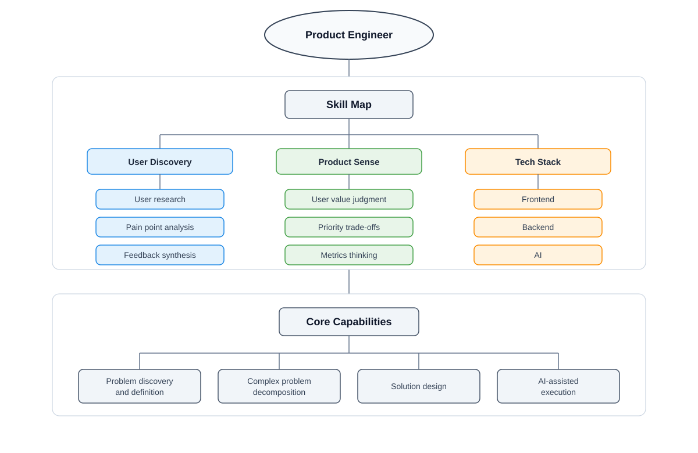

# Goal

Explore a core thesis: product engineering represents a promising career evolution for traditional SDEs in the AI era.

- Impact of AI on the traditional SDLC
- Refocusing SDE capabilities in the AI era
- Building end-to-end product engineering capabilities

<!--more-->

# What

A product engineer bridges product judgment with end-to-end software delivery.

- Understands user pain points and strategic product goals
- Makes architectural and technical decisions through product trade-offs
- Owns complete delivery from initial concept to deployment
- Evaluates post-launch impact and iterates based on user feedback

# Why

## The Traditional Product Lifecycle

Consider a typical product lifecycle, where each layer pairs a core challenge with its corresponding value creation.

| Layer | Stage | Key Problem | Value Created |
|---|---|---|---|
| Business | User Demand | Which user problem is worth solving? | - Discover real user problems - Clarify needs and pain points |
| Business | Commercial Revenue | Why is this product worth corporate investment? | - Estimate revenue potential - Evaluate profit, growth, or strategic value |
| Product | Solution Definition and Design | What product solution should address it? | - Define the product solution - Shape the user experience - Align key trade-offs |
| Technology | Technical Planning | How can the solution be deployed reliably? | - Clarify requirements - Design architecture - Create an implementation plan |
| Technology | Implementation | How do we build it and deliver it to users? | - Turn plans into software - Ensure quality through testing |
| Decision | Measurement and Iteration | Did the result match expectations? | - Validate actual impact - Reduce uncertainty for the next decision - Decide the next product or business move |

Mapping these stages to typical organizational roles:

| Layer | Problem It Solves | Value It Creates | Typical Roles |
|---|---|---|---|
| Strategic Direction | Which problem should we solve, and why now? | Sets direction, defines success, allocates resources, makes trade-offs | Founder, Executive, Product Leader, Business Owner |
| Tactical Planning | What should we build, and how should we organize the work? | Turns direction into plans, requirements, designs, priorities, and coordination | PM, Designer, Tech Lead, Data Analyst |
| Execution | How do we build, launch, operate, and improve it? | Delivers systems, releases safely, observes feedback, and improves | SDE, QA, SRE, Support, Sales, Marketing |

## AI's Impact on the SDLC Process

### AI Capabilities and Limitations

The impact of AI hinges primarily on the clarity of task boundaries.

- Strengths: Tasks with well-defined inputs, outputs, deterministic rules, and objective evaluation criteria.
  - Examples: Code implementation, automated testing, documentation generation, and routine technical research.
- Limitations: Highly complex or ambiguous domain work where inputs, constraints, and success criteria remain fluid.
  - Examples: Problem framing, synthesizing user context, commercial trade-offs, product judgment, and executive decision-making.

Related exploration: [AI exploration notes](/en/docs/ai/agent-sdk-design/)

### Impact on Organizational Layers

Based on the role taxonomy above, AI affects each layer to varying degrees.

*Note: The estimations below reflect personal engineering experience and domain intuition rather than formal empirical metrics, illustrating the comparative leverage of current AI capabilities across layers.*

| Layer | AI Impact | Reason |
|---|---|---|
| Strategic Direction | 30% | Strategy heavily relies on qualitative context, business intuition, resource allocation, and organizational accountability |
| Tactical Planning | 50% | Planning combines structured workflows with ambiguous trade-offs across product design, telemetry, and architecture |
| Execution | 70% | Execution operates within well-defined parameters, inputs, outputs, and programmatic evaluation |

### Organizational Shifts and Market Demand

These dynamics explain why execution-heavy roles and middle-layer coordination functions face heightened pressure during organizational restructuring. Beyond AI adoption, macroeconomic factors—including capital costs, hiring cycles, corporate rightsizing, and operational efficiency mandates—also drive this shift.

As organizations flatten and efficiency expectations rise, demand is growing for a distinct candidate profile: engineers who can navigate ambiguity, execute cross-functional trade-offs, leverage AI for multiplier-level delivery, and bridge product strategy, technical implementation, and business outcomes.

Market signals corroborating this trend:

- Skill demand is converging around AI literacy combined with human synthesis. The [WEF's Future of Jobs Report 2025](https://www.weforum.org/publications/the-future-of-jobs-report-2025/in-full/3-skills-outlook/) highlights AI and big data among top-growing skill sets, alongside analytical thinking, creative problem-solving, leadership, and collaboration.
- The SWE talent landscape is evolving structurally. [LinkedIn's 2026 U.S. Software Engineer Talent Landscape](https://economicgraph.linkedin.com/content/dam/me/economicgraph/en-us/PDF/us-software-engineer-talent-landscape-2026.pdf) notes that new software engineering hires are increasingly evaluated on cloud platforms and rapid AI tool integration.
- Enterprise AI integration spans beyond dedicated AI research roles. [PwC's 2026 AI Jobs Barometer](https://www.pwc.com/gx/en/issues/artificial-intelligence/job-barometer/aijb-2026-us.pdf) demonstrates surging demand for both AI specialized developers and AI-enabled functional roles.

## Emerging Value Domains and Career Paths for SDEs

### Defining the New Opportunity

Within the product lifecycle, a viable career pivot for SDEs must satisfy three criteria:

- High resistance to AI automation in the short term.
- A critical, indispensable role within the product lifecycle.
- Direct alignment with software engineering leverage.

| Layer | Short-Term AI Resistance | Position in Product Lifecycle | How SDEs Can Participate |
|---|---|---|---|
| Strategic Direction | High: requires handling ambiguous goals, business context, and risk ownership | Defines target outcomes and strategic priorities | Support research, frame technical problems, evaluate ROI |
| Tactical Planning | Medium: mixes structured domain tasks with ambiguous trade-offs | Translates vision into actionable product, technical, and execution roadmaps | Decompose systems, establish constraints, architect implementation paths |
| Execution | Low: defined by clear inputs, outputs, and validation metrics | Converts technical specifications into functional software and user telemetry | Use AI tooling to accelerate development, testing, and deployment loops |

### Structural Career Paths

SDEs generally face two strategic trajectories:

- Deepening within a single layer: Specializing further in a discrete domain such as architecture, execution, or product strategy.
- Connecting across layers: Integrating strategy, planning, and execution into an end-to-end outcome loop.

The cross-layer connecting path offers higher leverage.

While deep single-layer expertise remains valuable, AI is transforming every individual tier. The primary opportunity lies in connecting these layers—converting ambiguous strategic vision into executable, measurable engineering workflows accelerated by AI.

In internet product organizations, Product Engineering serves as the primary implementation of this cross-layer role.

| Dimension | Business Team | Infra Team |
|---|---|---|
| Domain | User-facing products and business outcomes | Internal platforms, tools, and engineering systems |
| Role Direction | Product Engineer | Platform Engineer / Infrastructure Architect |
| Value Chain | User problem discovery Business value judgment Product solution decomposition AI-assisted delivery | Internal need discovery Platform value judgment Technical solution decomposition AI-assisted delivery |
| Capability Depth | Heavier focus on business value judgment and product trade-offs | Heavier focus on architecture, systems, performance, reliability, and code quality |

**The remainder of this article focuses on the Product Engineer path rather than Infrastructure Architecture.**

- My background primarily spans deep application engineering, frameworks, and system architecture.
- My current focus centers on the Product Engineer archetype.

# How

This section presents a high-level execution framework for product engineers.

The sequence follows three phases: evaluating direction viability, validating technical and product feasibility, and executing high-quality delivery.

What distinguishes a Product Engineer from a traditional Product Manager or Tech Lead is the capability to seamlessly embed product discovery directly into the engineering lifecycle: moving from product hypothesis to rapid prototyping, architectural trade-offs, telemetry instrumentation, delivery, and iterative optimization.

## Managing Product Risk

Prior to committing substantial engineering resources, core product risks must be systematically evaluated and mitigated.

| Risk | Key Question | Method | Output |
|---|---|---|---|
| User Value | Do users really need it? | Customer interview, usage intent, willingness to pay | Evidence of user demand |
| Usability | Can users use it smoothly? | Low-fi prototype, task walkthrough | Usability risk assessment |
| Feasibility | Can the team build it? | Technical spike | Technical feasibility proof |
| Viability | Should the company invest in it? | Stakeholder review | Business viability assessment |

## Product Discovery

Product discovery reduces uncertainty before locking in solutions.

| Step | Key Question | Method | Output |
|---|---|---|---|
| Problem Definition | Who is the user, what is the scenario, and what pain exists? | Customer interview, feedback analysis | Problem statement |
| Hypothesis | What change do we expect? | Hypothesis modeling | Testable hypothesis |
| Validation | How do we test whether the hypothesis is true? | Prototype, user testing, A/B experiment | Validation result |
| Metrics | How do we know whether it works? | Business metrics, behavior metrics | Success criteria |
| Decision Making | Should we continue, iterate, or stop? | Go / Pivot / Kill review | Decision |

## Delivery and Execution

Delivery transforms validated hypotheses into resilient software and measurable business outcomes.

| Step | Key Question | Method | Output |
|---|---|---|---|
| Architecture | How should the validated direction map to a technical structure? | Architecture design, trade-off review | Architecture decision |
| Build | How should the solution be implemented? | Coding, code review, testing, continuous delivery | Working software |
| Measure | Did the solution work as expected? | Metrics tracking, user behavior observation | Outcome signal |
| Iterate | What should change next? | Data review, feedback review, small iterations | Next version |