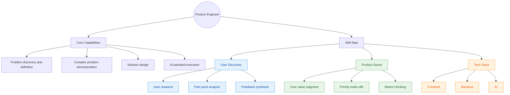

# Goal

Explore why product engineering is one possible career direction for traditional SDEs in the AI era, as AI changes the cost structure of software development.

- How AI influences the traditional SDLC process
- What SDEs could do in the AI era
- How to develop product engineering capability

# What

A product engineer is an engineer who can connect product judgment with end-to-end software delivery.

- Understands user problems and product goals
- Makes technical decisions based on product trade-offs
- Delivers software end to end
- Measures outcomes and iterates based on feedback

# Why

## The Traditional Product Lifecycle

The first table breaks down the common product lifecycle by problem and value.

| Layer | Stage | Key Problem | Value Created |
|---|---|---|---|
| Business | User Demand | What real user problem creates an opportunity? | - Discover user problems - Clarify needs and pain points |
| Business | Commercial Revenue | What business return justifies the product? | - Clarify revenue potential - Evaluate profit, growth, or strategic return |
| Product | Solution Definition and Design | What product solution should address it? | - Define the product solution - Shape the user experience - Align key trade-offs |
| Technology | Technical Planning | How can the solution be built reliably? | - Clarify requirements - Design architecture - Create an implementation plan |
| Technology | Implementation | How can the system be built and delivered to users? | - Turn plans into software by coding - Ensure quality through testing |
| Decision | Measurement and Iteration | Did it create the expected results? | - Validate actual impact - Reduce decision uncertainty - Guide the next product or business move |

The second table maps this lifecycle to common role categories.

| Layer | Problem It Solves | Value It Creates | Typical Roles |
|---|---|---|---|
| Strategic Direction | Which problem should we solve, and why now? | Sets direction, defines success, allocates resources, makes trade-offs | Founder, Executive, Product Leader, Business Owner |
| Tactical Planning | What should we build, and how should we organize the work? | Turns direction into plans, requirements, designs, priorities, and coordination | PM, Designer, Tech Lead, Data Analyst |
| Execution | How do we build, launch, operate, and improve it? | Delivers working systems, releases safely, observes reality, fixes and improves | SDE, QA, SRE, Support, Sales, Marketing |

## AI's Impact on the SDLC Process

### What AI Does Well and Does Not Do Well

AI's impact depends on how clear the task is.

- Good at: tasks with clear input, output, rules, and evaluation criteria.
    - Examples: coding, testing, documentation, and routine technical research.
- Weak at: complex and ambiguous work where the input, output, constraints, or success criteria are unclear.
    - Examples: problem framing, user context, business trade-offs, product judgment, and final decision making.

Related exploration: [AI exploration notes]()

### Impact on Different Role Layers

From the role-category table, the three layers are affected by AI at different levels.

| Layer | AI Impact | Reason |
|---|---|---|
| Strategic Direction | 30% | Strategy depends heavily on ambiguous context, business judgment, resource allocation, and accountability |
| Tactical Planning | 50% | Planning contains both structured work and ambiguous trade-offs across product, design, data, and technology |
| Execution | 70% | Execution has more clear inputs, outputs, rules, and evaluation criteria |

### Impact on Company Organization and Market Demand

This helps explain why many layoffs and role reductions are concentrated in execution-heavy roles and some middle-layer coordination roles.

After organization structures adjust, new demand appears for people who can handle unclear problems, make cross-functional trade-offs, use AI to increase delivery leverage, and connect product decisions, technical delivery, and business outcomes.

Evidence from hiring market:

- [WEF's Future of Jobs Report 2025](https://www.weforum.org/publications/the-future-of-jobs-report-2025/in-full/3-skills-outlook/) lists AI and big data among fast-growing skills, while also emphasizing analytical thinking, creative thinking, leadership, and collaboration as critical human skills.
- [LinkedIn's 2026 U.S. Software Engineer Talent Landscape](https://economicgraph.linkedin.com/content/dam/me/economicgraph/en-us/PDF/us-software-engineer-talent-landscape-2026.pdf) says the SWE market is adjusting to AI through skills, with new hires emphasizing cloud platforms and fast-growing AI-related tools.
- [PwC's 2026 AI Jobs Barometer](https://www.pwc.com/gx/en/issues/artificial-intelligence/job-barometer/aijb-2026-us.pdf) shows growing demand for AI-related roles and AI user roles, not only AI developer roles.

## New Value Areas and Career Directions for SDEs

### Where the New Direction Comes From

From the traditional product lifecycle, the new direction should come from areas that meet three conditions:

- AI will not do them well in the short term.
- Value is clearly created in the traditional product lifecycle.
- We can participate in them with software engineering leverage.

| Layer | AI Short-term Difficulty | Value in Product Lifecycle | How We Can Participate |
|---|---|---|---|
| Strategic Direction | High: unclear goals, business context, and accountability | Decides why to build and what outcome matters | Support research, frame problems, evaluate value |
| Tactical Planning | Medium: mixed structured tasks and ambiguous trade-offs | Turns direction into product, technical, and execution plans | Decompose problems, clarify constraints, design solution paths |
| Execution | Low: clearer inputs, outputs, and evaluation criteria | Turns plans into software and feedback | Use AI to accelerate coding, testing, and iteration |

### What the New Value Chain Is

There are two possible paths:

- Single-layer depth: becoming stronger in one layer, such as strategy, planning, architecture, or execution.
- Cross-layer connection: connecting strategy, planning, and execution into a coherent outcome.

I would recommend cross-layer connection more.

Based on the layer analysis above, single-layer depth is still valuable, but each layer is already being changed by AI in different ways. The more important opportunity is to connect the layers and turn unclear goals into executable, AI-assisted outcomes.

For common internet-company teams, Product Engineering is one concrete path to cross-layer connection.

| Dimension | Business Team | Infra Team |
|---|---|---|
| Domain | User-facing products and business outcomes | Internal platforms, tools, and engineering systems |
| Role Direction | Product Engineer | Platform Engineer / Infrastructure Architect |
| Value Chain | User problem discovery Business value judgment Product solution decomposition AI-assisted delivery | Internal need discovery Platform value judgment Technical solution decomposition AI-assisted delivery |
| Capability Depth | Higher requirement on business value judgment and product trade-offs | Higher requirement on architecture, systems, performance, reliability, and code quality |

**In the rest of this article, I will focus on Product Engineer instead of Infrastructure Architect.**

- I have already reached a top-tier level across application, framework, and system architecture.
- I am now more interested in the Product Engineer direction.

# How

## Product Risk

Use product risk to evaluate whether a product direction is worth building before spending too much delivery effort.

- User value: whether the problem matters to users
- Usability: whether users can understand and use the solution
- Feasibility: whether the team can build the solution well
- Viability: whether the solution works for the business

## Discovery

Use discovery to reduce uncertainty before committing to a specific solution.

- Problem definition: clarify what problem is being solved
- Hypothesis: describe the expected user or business impact
- Validation: test whether the hypothesis is true
- Metrics: define how success will be measured
- Decision making: choose whether to continue, change, or stop

## Delivery

Use delivery to turn validated direction into working software and measurable outcomes.

- Architecture: design a technical structure that supports the product goal
- Implementation: build the solution with quality and speed
- Measurement: observe whether the solution creates the expected result
- Iteration: improve the solution based on evidence and feedback
